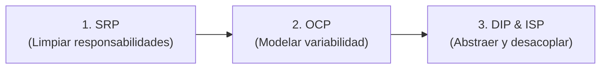

# 🍻 Bar MVC Demo — Arquitectura & Refactorización SOLID

¡Bienvenidos a **Bar MVC Demo**! Este es un proyecto en **C# / .NET** diseñado para estudiar, analizar y poner en práctica:
1. El patrón de arquitectura **MVC (Modelo - Vista - Controlador)** en una aplicación de consola.
2. Los principios de diseño de software **SOLID**.
3. El proceso de **refactorización progresiva**, comparando el código antes y después de aplicar buenas prácticas.

---

> 💡 **Observación sobre Refactorización:**  
> Aunque en este repositorio nos enfocamos puntualmente en refactorizar para aplicar los principios **SOLID**, vale aclarar que el concepto de refactorización es mucho más amplio.  
> Como define **Martin Fowler** en su libro clásico, la *refactorización* es una técnica disciplinada para reestructurar el código interno sin alterar su comportamiento externo. Fowler introduce el concepto de **Code Smells** (síntomas de mal código) como disparadores para refactorizar, identificando problemas como *Long Method* (métodos demasiado extensos), *Large Class* (clases gigantes) o *Complex Switch* (estructuras condicionales rígidas).

---

## 🏛️ ¿Cómo está pensado el patrón MVC aquí?

La aplicación simula la atención en la barra de un bar:
* **Modelo (`Models/`)**: Contiene las entidades y la lógica de negocio del dominio (`Cerveza`, `Barman`).
* **Vista (`Views/`)**: Encargada de mostrar la información al usuario y solicitar entradas (`ConsolaView`).
* **Controlador (`Controllers/`)**: Orquesta el flujo de la aplicación (`BarController`), respondiendo a las acciones del usuario, invocando al Modelo y ordenando a la Vista qué presentar.

---

## 🧭 ¿Cómo navegar por la evolución del proyecto?

El repositorio está organizado de forma cronológica mediante **Tags (etiquetas de Git)** para que puedas viajar en el tiempo y ver exactamente cómo fue evolucionando el diseño:

```bash
# Ver el estado inicial (con trampas):
git checkout paso-0-inicial

# Ver la corrección de SRP y MVC:
git checkout paso-1-srp

# Ver la corrección de OCP (polimorfismo y extensibilidad):
git checkout paso-2-ocp

# Ver la arquitectura final desacoplada con DIP e ISP:
git checkout paso-3-dip-isp

# Volver a la última versión disponible:
git checkout main
```

> **Tip:** También podés ver las diferencias directamente en GitHub ingresando a la pestaña **Commits** o comparando las versiones para ver en verde y rojo qué líneas cambiaron en cada refactorización.

---

## 📍 Paso 0: Estado Inicial (¡Trampas y violaciones adrede!)

La versión identificada con la etiqueta `paso-0-inicial` compila y funciona, pero fue programada **con errores y antipatrones adrede** para analizar.

### 🔍 Preguntas disparadoras para analizar el código:
1. **Responsabilidades mezcladas (SRP & MVC):**
   * ¿Qué método del Modelo está haciendo operaciones de entrada/salida que deberían pertenecer a la interfaz de usuario?
   * ¿El Controlador le pide a la Vista que capture los datos, o accede directamente a recursos de la consola?
2. **Dificultad de extensión (OCP):**
   * Si el bar decide incorporar cerveza *IPA*, *Roja* o *Honey*, ¿cuántos archivos y estructuras (`enum`, `if/else`, `switch`) tendríamos que modificar? ¿Qué principio estamos violando?
3. **Acoplamiento rígido (DIP):**
   * ¿Qué clases instancian directamente a otras usando `new`? 
   * ¿Podríamos cambiar la consola por una interfaz gráfica (WPF/MAUI) o probar el controlador con pruebas unitarias sin modificar el código fuente?

---

## 📍 Paso 1: Principio de Responsabilidad Única (SRP) y Limpieza de MVC

En esta etapa corregimos las fugas de responsabilidades y restauramos la separación limpia de capas en MVC:

1. **`Cerveza.cs` (Modelo):**
   * **Antes:** Hacía `Console.WriteLine(...)` dentro de `Servir()`.
   * **Problema:** Violaba **SRP** y **MVC**, ya que el Modelo asumía la responsabilidad de presentar información y quedaba fuertemente acoplado a la consola.
   * **Solución:** Ahora `Servir()` retorna un `string`. El Modelo procesa datos y reglas de negocio, dejando la presentación a quien le corresponde.

2. **`ConsolaView.cs` (Vista):**
   * **Mejora:** Se crearon los métodos `LeerOpcion()` (para centralizar la captura del teclado) y `MostrarCervezaServida(mensaje)` (para presentar el texto producido por el Modelo).

3. **`Barman.cs` (Modelo):**
   * **Mejora:** `AtenderPedido()` ahora retorna el resultado de la acción en lugar de depender de efectos colaterales de consola.

4. **`BarController.cs` (Controlador):**
   * **Antes:** Ejecutaba `Console.ReadLine()` directamente.
   * **Problema:** Violaba **SRP**, involucrando al Controlador en detalles de I/O de bajo nivel.
   * **Solución:** Delega la captura a `_view.LeerOpcion()` y coordina el flujo enviando los resultados a la Vista.

---

## 📍 Paso 2: Principio Abierto/Cerrado (OCP) y Extensibilidad

En esta etapa resolvemos la rigidez del código para agregar nuevas variedades de cervezas:

1. **Polimorfismo en `Cerveza.cs`:**
   * **Antes:** Existía un `enum TipoCerveza` y una sola clase con un `if/else` en `Servir()`. Agregar una variedad exigía **modificar** código existente.
   * **Solución:** Se transformó `Cerveza` en una clase abstracta base con implementaciones concretas (`CervezaRubia`, `CervezaNegra`).
   * **Demostración de OCP:** Se agregó **`CervezaRoja`** únicamente extendiendo `Cerveza`, sin tocar ni una sola línea de `CervezaRubia` ni de `CervezaNegra`.

2. **`Barman.cs` desacoplado del enum:**
   * Ahora el método `ServirCerveza(Cerveza cerveza)` recibe cualquier subtipo de `Cerveza` de forma polimórfica.

3. **Menú dinámico en `ConsolaView.cs`:**
   * `MostrarMenu(List<Cerveza> cervezas)` itera sobre la carta disponible en vez de tener opciones fijas en texto plano.

4. **Eliminación del switch rígido en `BarController.cs`:**
   * La selección del usuario se valida numéricamente contra la carta. Ya no hay `case "1"`, `case "2"` cableados a mano.

---

## 📍 Paso 3: Inversión de Dependencias (DIP) y Segregación de Interfaces (ISP)

En esta etapa final alcanzamos el desacoplamiento total de la arquitectura:

1. **Definición de Contratos / Interfaces (`IBarman`, `IBarView`):**
   * **Segregación de Interfaces (ISP):** Se crearon contratos pequeños y específicos que definen exactamente lo que el Controlador necesita para operar.
   * **Inversión de Dependencias (DIP):** Los módulos de alto nivel (`BarController`) ya **no dependen** de módulos de bajo nivel (`Barman`, `ConsolaView`), sino de **abstracciones**.

2. **Inyección de Dependencias en `BarController.cs`:**
   * El controlador ya no tiene ningún operador `new`. Recibe `IBarman`, `IBarView` y la colección de cervezas `IReadOnlyList<Cerveza>` por constructor.
   * **Beneficio directo:** Ahora podemos crear pruebas unitarias inyectando mocks, o cambiar la consola por una vista Web / WPF sin modificar una sola línea del controlador.

3. **`Program.cs` como *Composition Root*:**
   * El punto de entrada es el único encargado de ensamblar e instanciar las piezas concretas y enlazarlas mediante sus interfaces.

---

## 🧠 ¿Por qué este orden de refactorización? (Guía metodológica)

Cuando nos encontramos con código legado o mal diseñado, **el orden en que aplicamos las mejoras importa muchísimo**. Seguir esta secuencia evita retrabajo y complejidad innecesaria:



### 1️⃣ Primero SRP: *Aclarar el "qué hace cada cosa"*
* **Por qué primero:** No podés abstraer ni desacoplar componentes si antes no sabés exactamente qué responsabilidad le toca a cada uno. Si extraés una interfaz de una clase que mezcla lógica de negocio con salida por consola, estás **abstrayendo el caos**.
* **Resultado:** Clases cohesivas, con una única razón para cambiar y delimitación estricta de capas (MVC).

### 2️⃣ Segundo OCP: *Reemplazar condicionales por polimorfismo*
* **Por qué en segundo lugar:** Una vez que los métodos tienen responsabilidades atómicas y limpias, es muy fácil detectar las estructuras rígidas (`enum`, `if/else`, `switch`). En este punto convertimos la variabilidad en jerarquías polimórficas o estrategias.
* **Resultado:** Un modelo de dominio flexible, abierto a incorporar nuevas variantes sin riesgo de romper las anteriores.

### 3️⃣ Al final DIP e ISP: *Extraer contratos e invertir dependencias*
* **Por qué al final:** Crear interfaces antes de tiempo suele producir interfaces sobrecargadas ("fat interfaces") que cambian constantemente. Cuando el diseño interno ya es estable, cohesivo y polimórfico, recién ahí extraemos los contratos mínimos e indispensables (ISP) y conectamos los módulos a través de esas abstracciones (DIP).
* **Resultado:** Código 100% testeable con mocks, modular y desacoplado, ensamblado en un único punto (*Composition Root*).

---

## 🎯 Conclusiones: ¿Qué ganamos con esta refactorización?

Al comparar el código entre `paso-0-inicial` y `paso-3-dip-isp`, los beneficios arquitectónicos son tangibles:

1. **🧪 Testabilidad (Testing Unitario):**
   * En el Paso 0 era imposible testear `BarController` sin abrir la consola y simular tipeo humano.
   * Ahora podemos escribir tests unitarios aislando el controlador con mocks de `IBarView` e `IBarman`.

2. **🔌 Intercambiabilidad de Vistas:**
   * La vista de consola (`ConsolaView`) puede ser reemplazada mañana por una interfaz gráfica (WPF, Avalonia, MAUI) o una API Web creando una clase que implemente `IBarView`, sin tocar una sola línea de lógica en `BarController`.

3. **🚀 Extensibilidad sin riesgo de regresiones (OCP):**
   * Agregar una nueva variedad de cerveza (ej. *Honey*, *IPA*) ya no implica modificar clases existentes ni correr riesgo de romper lo que ya funciona. Solo creamos una nueva clase derivada de `Cerveza` y la sumamos a la carta en el punto de composición (`Program.cs`).

4. **🧩 Bajo Acoplamiento y Alta Cohesión:**
   * Cada clase tiene una única responsabilidad bien delimitada (SRP).
   * Los componentes colaboran a través de contratos claros (ISP), dependiendo de abstracciones y no de detalles concretos (DIP).

---

## 🗺️ Hoja de Ruta de la Refactorización

- [x] **Paso 0 (`paso-0-inicial`)**: Estado base funcional con violaciones intencionales a SOLID y MVC.
- [x] **Paso 1 (`paso-1-srp`)**: Aplicación del Principio de Responsabilidad Única (SRP) y delimitación estricta de MVC.
- [x] **Paso 2 (`paso-2-ocp`)**: Aplicación del Principio Abierto/Cerrado (OCP) mediante polimorfismo.
- [x] **Paso 3 (`paso-3-dip-isp`)**: Inversión de Dependencias (DIP) y Segregación de Interfaces (ISP).
